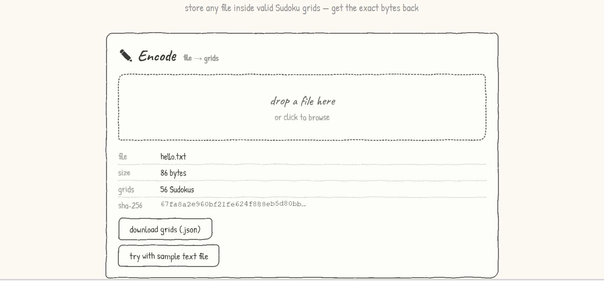
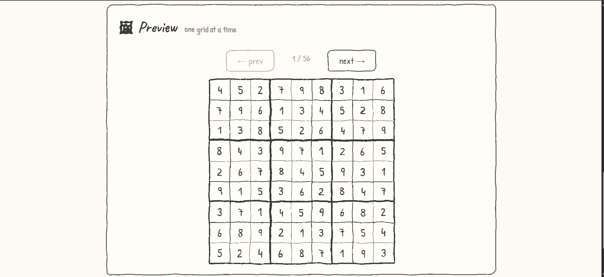

# *Sudoku* 

(*This app stores data into valid Sudoku games*)

(*It stores 2 bytes per Sudoku grid , so it can take many to store a large file ;_;*)

## What to do:

1. To Encode 
- Go to https://coderx838.github.io/Sudoku (this is the app)
- You can put a file in encode section or use sample text file option there.
- It will show you metadata of storage like how much Sudoku grid used to store the file , sha256 sum etc.
- You can also view the preview of the all Sudoku grids generated , after this click the "download grids(.json)" button.
- Keep the downloaded json file safe its your storage disk.

2. To Decode
- Put the downloaded json file into the decode section.
- It will recover the file from the game , the you can download the recovered file (yay !!).

## Screenshots:

(*this is where to encode*)

(*this is preview!!*)

--------------------------------------------------------------------------------------------------------------

*Made by a teen with love for [hackclub ysws](https://crescent.hackclub.com/)*
